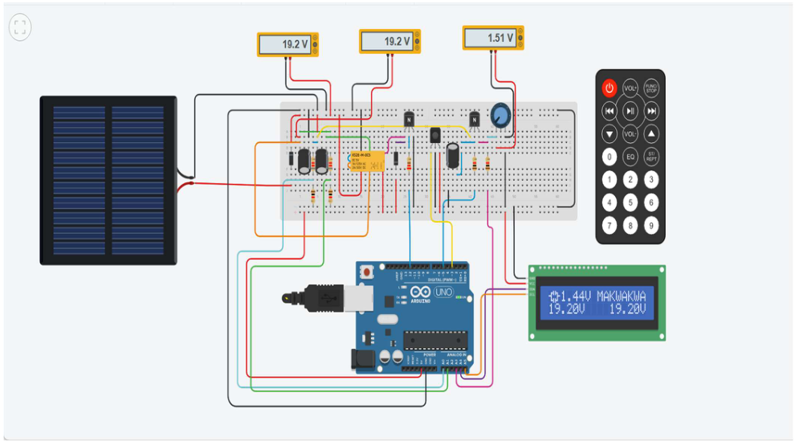
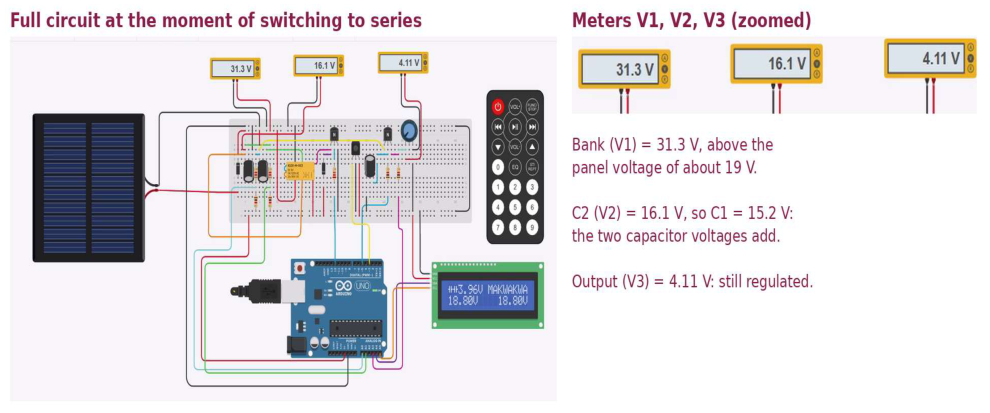
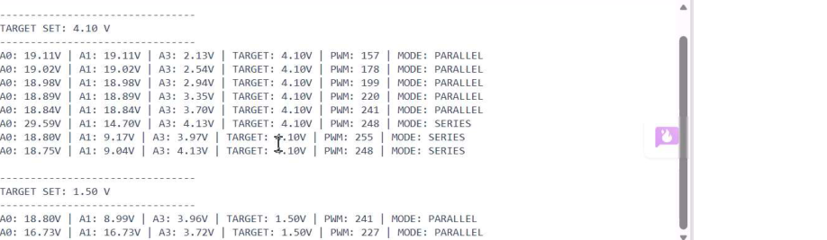
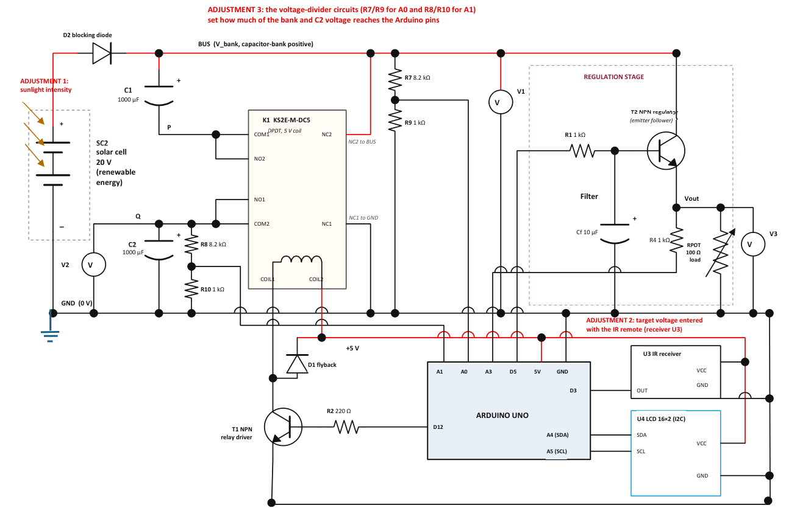
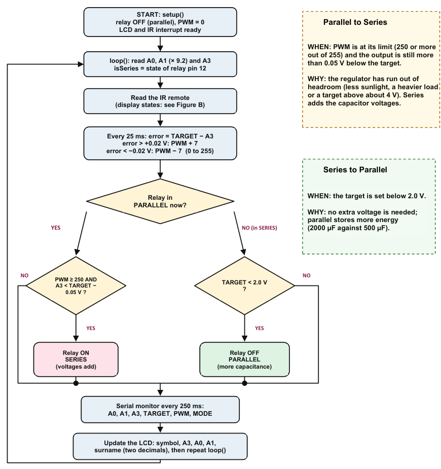
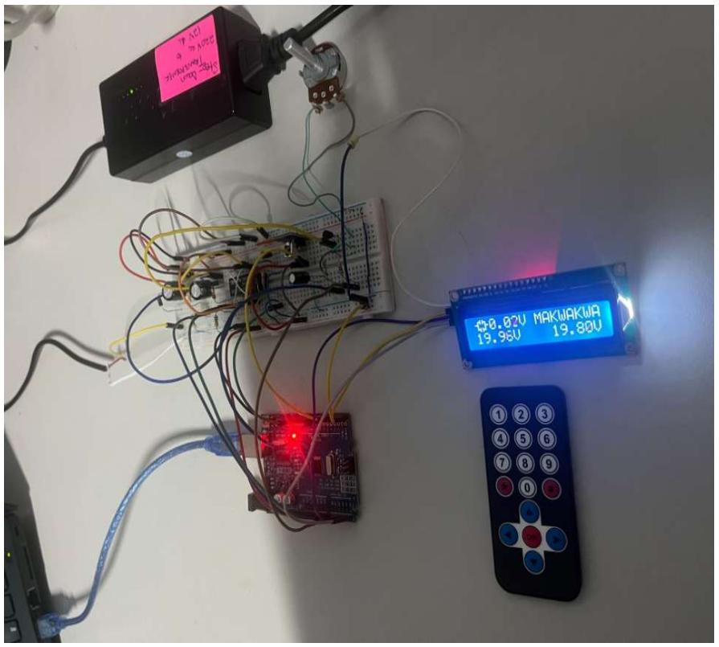

# Solar Charge Controller with Capacitor Storage (Arduino)

An Arduino solar charge controller that replaces the battery with **two 1000 µF capacitors**. Because a
capacitor's voltage falls as it discharges, the controller does two things automatically:

1. **Switches the capacitors between parallel and series with a relay** – parallel stores the most
   energy; series adds the two voltages when the regulator runs out of headroom.
2. **Regulates the output in a closed loop** – it adjusts a PWM signal until the output matches a target
   voltage (0–4.3 V) entered on an **infrared remote**.

A 16×2 I²C LCD shows the mode (custom symbols), the output voltage and both capacitor voltages, and the
serial monitor logs every step so each switch can be checked against voltmeters.

Embedded Systems 3 project, B.Eng.Tech Computer Engineering, Cape Peninsula University of Technology (2026).
Designed and tested in **Tinkercad**, then built on a breadboard with a real Arduino Uno.

## Results

| What | Result |
|---|---|
| Output regulation | Output held at **3.97–4.11 V** (target 4.10 V) while the capacitor bank fell from 31.3 V to 18.8 V |
| Parallel → series switch | Triggered automatically when PWM ≥ 250 and output still > 0.05 V below target; bank jumped to 31.3 V (C2 16.1 V + C1 15.2 V) |
| Series → parallel switch | Triggered when the target is set below 2 V; capacitor voltages equal again (18.9 V / 18.9 V) |
| Measurement accuracy | LCD matched the voltmeters within 0.04 V on the bank and C2 (e.g. 18.84 V vs 18.8 V) |
| Calculations vs measurement | Charging voltage 19.3 V calculated, 19.4 V measured |

*Serial monitor: target set to 4.10 V, PWM rises in parallel (157 → 241), the relay switches to SERIES,
then target 1.50 V returns the circuit to PARALLEL.*

## How it works

- **Energy path:** solar cell → blocking diode → capacitor bank (C1, C2) → NPN emitter-follower regulator → load.
- **Relay (DPDT):** coil off = parallel (2000 µF, default and safe state after reset); coil on = series (500 µF, double voltage).
  Driven by an NPN transistor with a flyback diode, because the 111 mA coil current is too much for an Arduino pin.
- **Sensing:** 8.2 kΩ / 1 kΩ dividers scale the bank (A0) and C2 (A1) voltages by 1/9.2, so a 33 V series bank
  stays below the 5 V ADC limit. The output is read directly on A3.
- **Regulation:** every 25 ms the error (target − output) moves the PWM up or down; an RC filter
  (1 kΩ, 10 µF, cut-off 15.9 Hz) turns the 976 Hz PWM into a steady base voltage.
- **Hysteresis:** switching to series needs PWM ≥ 250, switching back needs a target below 2 V (≈ PWM 138),
  so the relay does not chatter between 2 V and 4.3 V.

## Problems I solved

| Problem | Fix |
|---|---|
| The `IRremote` and `LiquidCrystal_I2C` libraries would not compile together in Tinkercad | Wrote my own **interrupt-driven NEC infrared decoder** (pulse-width timing with `micros()`), so no IR library is needed |
| Electrical noise was accepted as button presses | Added NEC inverse-byte validation to reject corrupted frames |
| The relay got stuck in series mode | Replaced one symmetric threshold with **state-dependent rules** (hysteresis) |
| The solar panel clamped the series voltage | Added a blocking diode between the panel and the capacitor bank |
| A0 saturated at 5 V in series mode | Recalculated the dividers (8.2 kΩ / 1 kΩ) from the worst-case 33 V |
| LCD corruption | Traced to a pin-13 conflict between the LCD data line and the IR library's LED |
| Datasheet check: 2N2222 is rated 30 V, but the series bank reaches 33 V | Documented; a real build needs a 40 V part such as the 2N2222A |

## Physical build

*Breadboard build on a bench supply (~19 V): the LCD shows the parallel symbol, output 0.02 V and the bank and C2 at 19.96 V and 19.80 V.*

## Hardware

Arduino Uno · DPDT relay (KS2E-M-DC5, 5 V) · 2 × 1000 µF / 40 V capacitors · 2 × NPN transistors ·
1N4001 diodes · 16×2 I²C LCD (0x27) · IR receiver + remote · resistors · 100 Ω load · 20 V solar cell (simulation) / bench supply (physical build)

| Pin | Use |
|---|---|
| A0 | Bank voltage (÷ 9.2 divider) |
| A1 | C2 voltage (÷ 9.2 divider) |
| A3 | Output voltage |
| D3 | IR receiver (interrupt) |
| D5 | PWM to the regulator |
| D12 | Relay driver |
| A4 / A5 | LCD (I²C SDA / SCL) |

## Run it

1. Open `firmware/solar_charge_controller/solar_charge_controller.ino` in the Arduino IDE (or paste it into Tinkercad Circuits).
2. Install the **LiquidCrystal I2C** library (Library Manager).
3. Upload to an Arduino Uno and open the serial monitor at **9600 baud**.
4. On the IR remote, press two digits to set the target: `4` then `1` = 4.1 V (maximum 4.3 V).

## Limitations and next steps

- Most measurements were taken in the Tinkercad simulation; real components may need re-calibration.
- Capacitors store much less energy than a battery (0.38 J in parallel), so runtime under load is short.
- Series-mode voltage imbalance between the capacitors is not actively corrected.
- Next: supercapacitors, active balancing, a bank-voltage check (A0) in the switch-back rule, and a smaller PWM step for a steadier output.

## Author

**Vulani Makwakwa** · B.Eng.Tech Computer Engineering (CPUT, 2026) · Cape Town · [GitHub](https://github.com/Vulaniperseve) · [LinkedIn](https://www.linkedin.com/in/vulani-makwakwa-24229a23a/)
